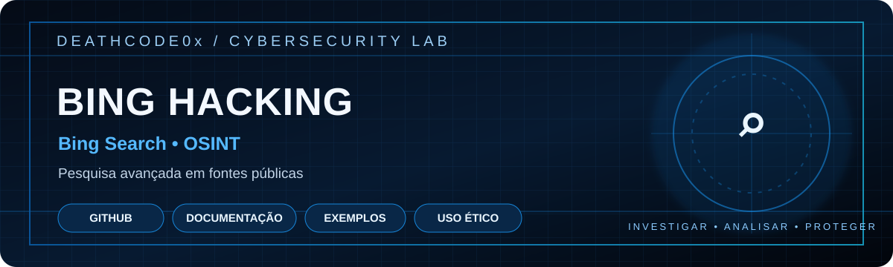

  
  
  
  

> Pesquisa avançada no Bing para reconhecimento de informações públicas.

---

# Bing Hacking

Anotações de pesquisa avançada no Bing para **OSINT passivo**, reconhecimento de superfície pública e auditorias autorizadas.

## Operadores úteis
| Operador | Finalidade |
|---|---|
| `site:example.com` | Limitar a busca a um domínio |
| `filetype:pdf` | Filtrar documentos PDF |
| `intitle:termo` | Procurar termo no título |
| `inurl:termo` | Procurar termo na URL |

Exemplo: `site:example.com filetype:pdf` em um domínio sob sua responsabilidade.

## Fluxo de trabalho
1. Defina por escrito o domínio e o escopo autorizado.
2. Faça buscas passivas usando informações públicas.
3. Registre consultas, data e evidências mínimas.
4. Confirme possíveis exposições com o proprietário.
5. Recomende correções e acompanhe a resolução.

## Limites
Não tente autenticar, explorar, enumerar contas, acessar conteúdo privado ou coletar dados pessoais. Respeite os termos do serviço e a legislação aplicável.

## Aviso legal
Projeto para estudo e defesa. Testes somente em ativos próprios ou mediante autorização explícita.
